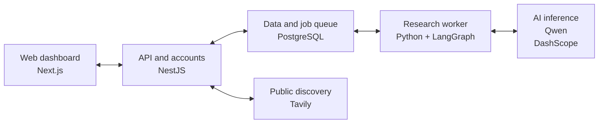

<p align="center">
  
</p>

<h1 align="center">Lead Trace</h1>
<p align="center"><strong>A source. A hypothesis. A better question.</strong></p>
<p align="center">
  <a href="https://leadtrace.online">Try Lead Trace</a> ·
  <a href="video/Lead-Trace-demo.mp4">Watch the demo</a> ·
  <a href="presentation/Lead-Trace-pitch-enhanced.pptx">View the pitch</a> ·
  <a href="#getting-started">Get started</a> ·
  <a href="#supporting-attachments">Explore the attachments</a>
</p>

## From InsightIQ to Lead Trace

<p align="center">
  
  &nbsp; → &nbsp;
  
</p>

We listened to feedback from industry professionals and used it to rethink the project's direction around the needs of sales teams. **InsightIQ is now Lead Trace.**

The project began with AI-assisted prospect research and cited Deal Briefs. We are building on that foundation toward a broader sales workflow that brings lead generation, research, and CRM together. The new name reflects that direction: helping teams follow a lead from discovery through the sales relationship.

Lead generation, CRM, and related capabilities are planned. We will refine the feature set, priorities, pitch, and documentation as development progresses and we gather further feedback. The working product described below provides the research and briefing foundation.

## Meet Lead Trace

Lead Trace currently provides an AI sales research assistant for **B2B sales teams, agencies, and founders**. Give it a prospect and describe what you sell. It finds public signals and turns them into a **cited Deal Brief** for meeting preparation or personalized outreach—with source links and visible research gaps.

We built the complete journey: a shared workspace, public-source discovery, AI evidence extraction, and briefs you can review and reuse. Its central feature is a **conversation angle**: a source claim, a clearly labeled hypothesis about your offer, and a question that tests whether the fit is real.

## Product tour

Click a preview to view the full desktop screenshot.

<table>
  <tr>
    <td width="50%" align="center">
      <strong>Landing page</strong><br />
      <a href="docs/assets/lead-trace-landing.png"></a><br />
      <sub>Discover what Lead Trace does.</sub>
    </td>
    <td width="50%" align="center">
      <strong>Dashboard</strong><br />
      <a href="docs/assets/lead-trace-dashboard.png"></a><br />
      <sub>See your workspace at a glance.</sub>
    </td>
  </tr>
  <tr>
    <td width="50%" align="center">
      <strong>New research</strong><br />
      <a href="docs/assets/lead-trace-new-research.png"></a><br />
      <sub>Choose a goal and add prospect context.</sub>
    </td>
    <td width="50%" align="center">
      <strong>Prospect library</strong><br />
      <a href="docs/assets/lead-trace-prospects.png"></a><br />
      <sub>Find prospects and open ready briefs.</sub>
    </td>
  </tr>
  <tr>
    <td width="50%" align="center">
      <strong>Deal Brief</strong><br />
      <a href="docs/assets/lead-trace-brief.png"></a><br />
      <sub>Prepare your next sales conversation.</sub>
    </td>
    <td width="50%" align="center">
      <strong>Evidence library</strong><br />
      <a href="docs/assets/lead-trace-evidence.png"></a><br />
      <sub>Inspect the sources behind the claims.</sub>
    </td>
  </tr>
  <tr>
    <td width="50%" align="center">
      <strong>Conversation angles</strong><br />
      <a href="docs/assets/lead-trace-angles.png"></a><br />
      <sub>Connect the evidence to a useful question.</sub>
    </td>
    <td width="50%" align="center">
      <strong>Personalized outreach</strong><br />
      <a href="docs/assets/lead-trace-outreach.png"></a><br />
      <sub>Adapt the draft, then copy or download it.</sub>
    </td>
  </tr>
</table>

*The landing page uses an illustrative example. Product screenshots show the current local app with deterministic demonstration fixtures, including a Tim Cook / Apple example. They do not represent a live research run, customer adoption, or measured sales results.*

## The idea: research with a purpose

A company profile can tell you what a business does. Preparing for a conversation means understanding **why your offer could matter to that prospect**. Lead Trace brings both sides together, keeping the evidence behind its suggestions within reach.

| Prepare for a meeting | Start a conversation | Check the evidence |
| --- | --- | --- |
| Talking points, discovery questions, likely objections, and next steps | Email and social drafts tailored to your prospect and offer | Source-linked signals, confidence scores, and clear research gaps |

## What makes the brief useful

- **Start with the evidence.** Each angle shows its exact cited claim and a link to inspect the source.
- **See the reasoning.** Possible relevance is marked as a hypothesis, followed by a question to validate it.
- **Keep the signal focused.** Offer-aware selection reduces duplicate events and static profile facts. Older or undated context cannot create false urgency.
- **Take the work with you.** Copy a question or the full CRM pack, download the brief with citations and gaps, or refresh it and compare changes.

## Getting started

1. **Enter your workspace.** [Create an account](https://leadtrace.online/sign-up) and verify your email.
2. **Add your context.** Enter a prospect's name, company, domain, or public profile, then describe what you sell.
3. **Choose your goal.** Pick meeting preparation or outreach and follow the research progress.
4. **Choose an angle.** Inspect its source, consider the possible fit, and use the question to start a conversation.
5. **Make it yours.** Review the gaps, adapt the draft, then copy or download the complete brief.

## How it works

**Your prospect + your offer → public sources → evidence → a cited Deal Brief**

The API saves your context and discovers relevant public sources with **Tavily**, with Wikipedia as a fallback when discovery returns no sources. A background **Python worker** uses **Qwen through DashScope** to extract and reconcile claims. **LangGraph** then assembles a brief for your chosen goal, and a citation check matches each key signal to its stored claim and source before completion.

You can inspect the result, copy or export it, retry failed research, or regenerate a brief from stored evidence and compare changes. Missing evidence appears as a gap. Citations make claims traceable; review the sources and recommendations before use. Outreach is drafted for you to review and send.

## How we built it

Our guiding idea was simple: **keep evidence behind the output, and uncertainty visible**. We store sources separately from claims and use accepted evidence to generate the brief. The web app handles the interactive experience while a background worker handles longer research jobs.



| Layer | Its job | Technology |
| --- | --- | --- |
| Web dashboard | Collect context and show progress, evidence, and briefs | Next.js, React, Tailwind CSS |
| API and accounts | Manage sign-in, workspaces, requests, and source discovery | NestJS, Better Auth, Tavily |
| Research worker | Extract evidence, generate briefs, and check citations | Python, LangGraph, Qwen/DashScope |
| Data and jobs | Store workspace records and queue background work | PostgreSQL, Prisma |

The web app runs on **Cloudflare Workers via OpenNext**. The API, research worker, and PostgreSQL run with **Docker Compose on a VPS**, with Nginx handling API traffic. PostgreSQL tracks the job queue, and database relationships keep research records tied to their workspace.

## Product direction

| Available in the current application | Planned direction |
| --- | --- |
| Prospect and offer context, public-source research, cited Deal Briefs, outreach drafts, shared briefs, and workspace accounts | Lead generation, CRM, and related sales workflows |

Planned capabilities do not yet represent a finalized feature list or a release commitment. We will update this distinction as each capability becomes available.

## Supporting attachments

The materials below use the new Lead Trace identity. The transition page shows the former InsightIQ logo alongside the new mark to explain the project’s evolution. Lead generation and CRM are identified as planned capabilities:

| Attachment | What's inside |
| --- | --- |
| [PowerPoint pitch](presentation/Lead-Trace-pitch-enhanced.pptx) · [PDF pitch](supporting/Lead-Trace-pitch.pdf) | 12-slide pitch covering the industry-feedback transition, current product, planned direction, screenshots, workflow, architecture, and team |
| [Narrated product demo](video/Lead-Trace-demo.mp4) · [Captions](video/Lead-Trace-captions.srt) | An 81-second, 1080p narrated walkthrough with the logo transition, current app captures, captions, and the planned product direction |
| [Project overview](supporting/Lead-Trace-overview.pdf) | A three-page overview of the transition, current research workflow, and planned lead generation and CRM direction |
| [Architecture diagram](supporting/Lead-Trace-architecture.png) | The system architecture shown above |
| [Workflow diagram](supporting/Lead-Trace-workflow.png) | From prospect context to a reviewable Deal Brief |
| [Demo inputs](supporting/Lead-Trace-demo-inputs.csv) | Fictional prospect and offer examples for demonstrations; not a benchmark or measured results |
| [All attachments](supporting/Lead-Trace-attachments.zip) | The supporting materials in one download |

The walkthrough uses the installed Samantha system voice. Its [narration script](video/Lead-Trace-narration.txt) is included for future voiceover revisions.

## Contributors

**Afnan Ahmad Tariq · Danyal Rana · [Hassan](https://github.com/hassandev03)**

## For developers

<details>
<summary><strong>Run locally</strong></summary>

You'll need Node.js/npm, Python 3.9+, and a running PostgreSQL 17 database accessible from your machine.

```bash
cp .env.example .env
npm install
npm run worker:setup
```

Update `.env` with your database credentials, a generated `BETTER_AUTH_SECRET`, and Resend credentials for verification email. For the full research workflow, add `TAVILY_API_KEY` and `DASHSCOPE_API_KEY`.

Use these local authentication settings and clear `BETTER_AUTH_COOKIE_DOMAIN`:

```dotenv
BETTER_AUTH_URL=http://localhost:3001
BETTER_AUTH_TRUSTED_ORIGINS=http://localhost:3000
BETTER_AUTH_COOKIE_DOMAIN=
WEB_ORIGIN=http://localhost:3000
```

Quote `.env` values that contain spaces (including `RESEND_FROM_EMAIL`). Start the application from a shell with these variables exported so the Python worker receives them too:

```bash
set -a
source .env
set +a
npm run db:migrate
npm run dev
```

Open `http://localhost:3000`. The API runs on port `3001`. The production Compose database does not publish a host port, so local Node/Python processes need a separately reachable database or a local Compose port override.

Quality checks: `npm run build`, `npm run lint`, `npm run check-types`, and `npm test`. The development task forwards the configured database, authentication, and research-provider variables to its services.

For browser tests while the app is already running:

```bash
E2E_WEB_PORT=3100 E2E_API_PORT=3101 npm run test --workspace=@lead-trace/web
```

The suite covers source matching, complete exports, refresh differences, and the mobile journey. Worker regressions cover identity matching, duplicate events, dated urgency, numeric grounding, and conversation-angle citations.

Repository layout: `apps/web`, `apps/api`, `apps/worker`, and `packages/db`.

### Rebrand deployment notes

The workspace scope is `@lead-trace`, the Python module is `lead_trace_worker`, and the CLI commands use the `lead-trace-` prefix. Run `npm install` and `npm run worker:setup` after updating to refresh package links and the editable Python installation.

The public site is `https://leadtrace.online`. The checked-in API default is `https://api.leadtrace.online`, with authentication cookies scoped to `.leadtrace.online`. The example sender is `auth@leadtrace.online` and the contact address is `hello@leadtrace.online`. Configure the API subdomain and verify both email addresses before production use.

The checked-in configuration uses Lead Trace names for the Cloudflare Worker, container images, deployment directory, and database defaults. Provision and verify the new DNS records, API origin, OAuth callbacks, email sender domain, TLS certificate, and Cloudflare route before deploying. These repository changes do not provision external infrastructure.

Compose uses the deployment directory name (`lead-trace`) as its project name. Copy the production environment and TLS files into the deployment directory before a release. When transferring existing data to a new VM, back up and restore PostgreSQL, retaining the configured database name and credentials. Renaming a default does not rename a populated PostgreSQL database.

The authentication cookie prefix and browser storage keys now use `lead-trace`. Existing users will need to sign in again, and local UI preferences and resend cooldown state will restart. Existing authenticator enrollments continue to use their saved labels until re-enrolled. Existing database content and previously sent messages retain their historical content.

</details>
