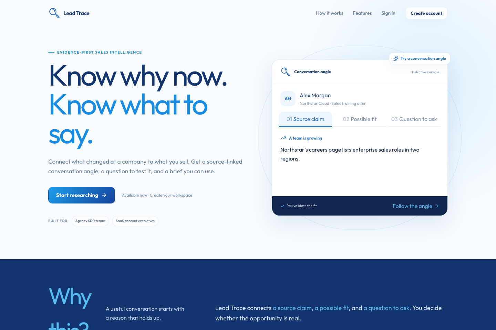
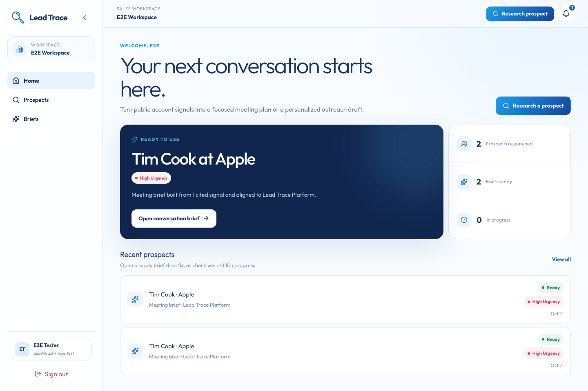
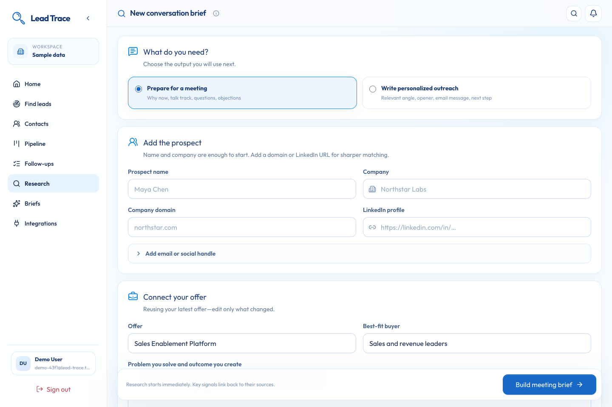
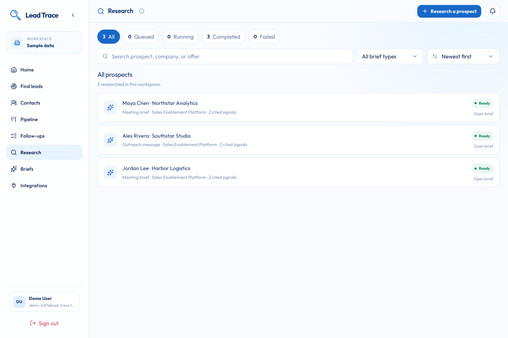
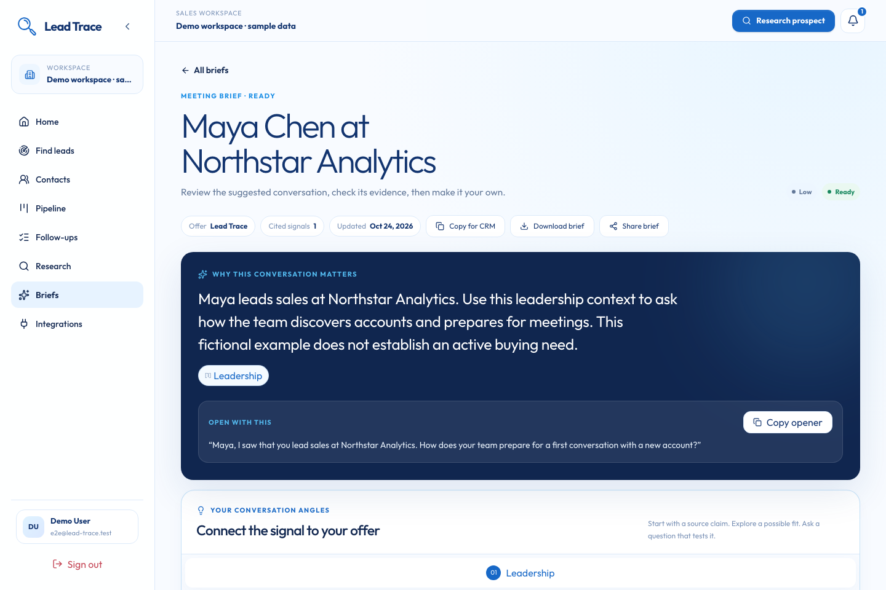
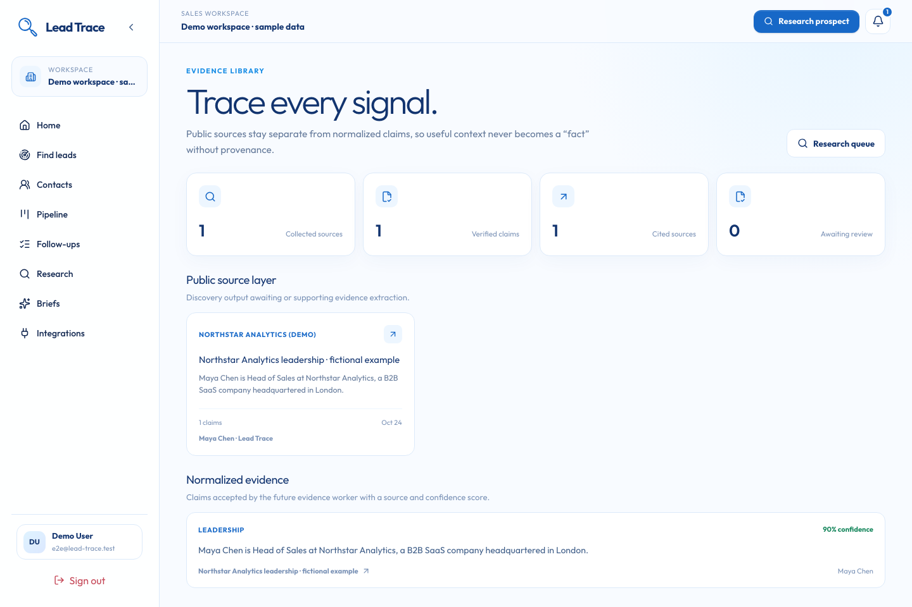
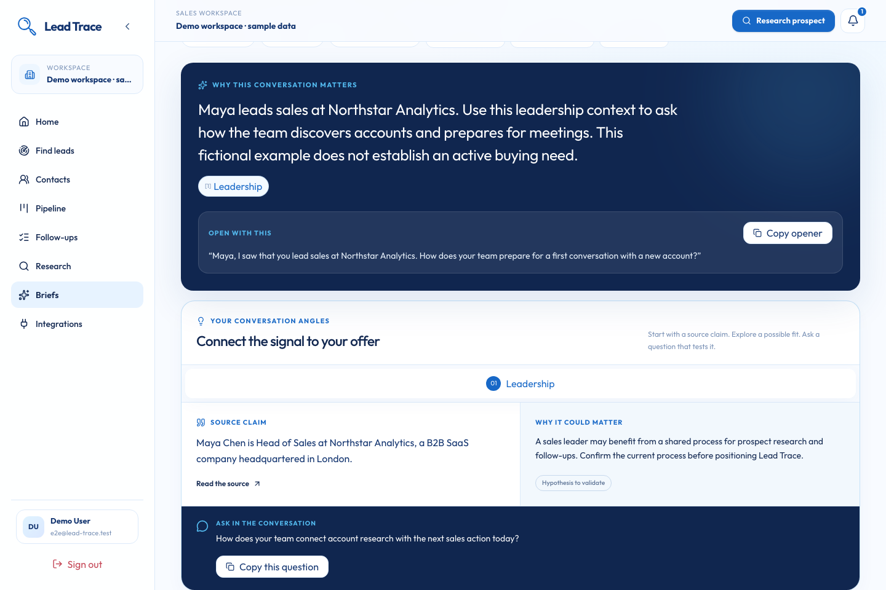
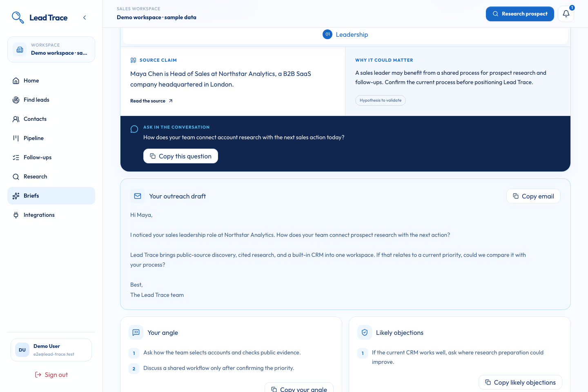
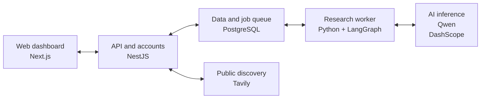

<p align="center">
  
</p>

<h1 align="center">Lead Trace</h1>
<p align="center"><strong>A source. A hypothesis. A better question.</strong></p>
<p align="center">
  <a href="https://leadtrace.online">Try Lead Trace</a> ·
  <a href="video/Lead-Trace-demo.mp4">Watch the demo</a> ·
  <a href="presentation/Lead-Trace-pitch-enhanced.pptx">View the pitch</a> ·
  <a href="#getting-started">Get started</a> ·
  <a href="#supporting-attachments">Explore the attachments</a>
</p>

## From InsightIQ to Lead Trace

<p align="center">
  
  &nbsp; → &nbsp;
  
</p>

We listened to feedback from industry professionals and used it to rethink the project's direction around the needs of sales teams. **InsightIQ is now Lead Trace.**

The project began with AI-assisted prospect research and cited Deal Briefs. We are building on that foundation toward a broader sales workflow that brings lead generation, research, and CRM together. The new name reflects that direction: helping teams follow a lead from discovery through the sales relationship.

The repository now includes built-in CRM and source-linked lead generation: persistent contacts, a deal pipeline, notes, follow-ups, CSV import/export, Google Calendar meeting creation, and a reviewed discovery-to-CRM workflow. Deeper integrations remain planned. We will refine the feature set and pitch as development progresses. The existing pitch and narrated demo show the research foundation and the original expansion roadmap.

## Meet Lead Trace

Lead Trace connects source-linked lead generation, a built-in CRM, and AI sales research for **B2B sales teams, agencies, and founders**. Discover and review leads, track contacts and deals, then describe what you sell. It finds public signals and turns them into a **cited Deal Brief** for meeting preparation or personalized outreach—with source links and visible research gaps.

We built the complete journey: a shared workspace, public-source discovery, AI evidence extraction, and briefs you can review and reuse. Its central feature is a **conversation angle**: a source claim, a clearly labeled hypothesis about your offer, and a question that tests whether the fit is real.

## Built-in CRM

Open **Contacts** to add or import a contact. Contact pages bring together company details, ownership, lifecycle, research history, deals, notes, follow-ups, and meetings. Existing research prospects remain available as contacts; new research can reuse a saved contact rather than create another record: a matching email links that contact without overwriting it, and the run still researches the details you submitted.

The everyday flow is **add a contact → prepare with research → track an opportunity → record the conversation → set a follow-up**. Research and Calendar are optional; a contact can move straight to a deal or follow-up. **Home** brings together contact and deal counts and the earliest open actions. Each contact highlights its next follow-up and keeps Add deal, Add note, Add follow-up, and Schedule meeting together. Briefs link back to the saved contact for the next action.

- **Pipeline:** new → qualified → proposal → negotiation → won/lost, with value, currency, owner, and expected close. Switch between Board and Table views; your browser remembers the choice. Create a deal directly from Pipeline by choosing a contact, filter by stage in either view, or edit a deal to move it forward. Totals stay separate by currency. Up to 500 recent deals are shown.
- **Follow-ups:** create an action directly from Follow-ups or from a contact, with a due date and workspace owner. Filter open actions by overdue, today, or upcoming in your local timezone. Completed actions are kept separately and can be reopened. These are tracked actions; automatic reminders are not implemented.
- **CSV:** import up to 500 contacts per batch using `name,email,company,domain,title,phone`; only `name` is required. The batch validates before writing. Email matches within a workspace are skipped without overwriting existing data. Export supports up to 10,000 contacts and neutralizes spreadsheet formulas. Names without emails are separate contacts.
- **Research:** open a contact and choose **Research contact**. The saved identity is used and each research run retains its immutable snapshot. Email matching is case-insensitive. Historical duplicate prospects are preserved with their research; the oldest matching record becomes the canonical email identity during migration.
- **Permissions:** workspace members collaborate on CRM records. Owners/assignees must be members of the active workspace. Contacts and their deals, notes, tasks, and meetings share compound tenant relationships. Wiping research data preserves CRM records; only owners can delete a workspace, which removes its CRM records.

Company details are currently stored on contacts. Shared company records, custom pipelines, contact merging/deletion, email integration, recurring lead searches, and two-way Calendar sync are future work. Contact pages display the latest 50 research runs and up to 100 of each other history type; the follow-up list shows up to 500 actions, open first.

## Lead generation

Open **Find leads** and describe the buyer role, industry/market, optional location, and additional keywords. Deep discovery first identifies companies, then searches their teams, reads full pages, and checks public registries. It investigates up to eight companies using at most 30 Tavily searches, full-page extraction for up to 16 URLs, and up to four company-site crawls of three pages each. Up to 64 source snapshots support up to 40 professional prospects. Quick discovery remains available with three searches and up to 18 snippets. Both modes use the existing Qwen model; no additional data subscription is required.

1. Start a search. A database-backed API worker continues discovery when you leave the page; return to see phase progress, sourced companies, registry records, and provider activity. Completed searches remain in the workspace's saved search list.
2. Review **Source-supported matches** first. These candidates have exact quoted evidence for every requested criterion and no detected source-age issue. **Needs review** holds missing evidence, old dated sources, and candidates saved before the evidence checks. Expand **Why this person matches** to inspect each criterion and its source. A source-supported match does not establish buying intent or verified contact details.
3. Qualify or dismiss candidates. A dismissed lead can be restored. Only qualified candidates can be saved to CRM.
4. Choose **Save to CRM**, review the name/company/role, and optionally add an independently known email or company domain. Emails are never guessed. A matching email reuses that contact; exact name/company matching applies only when no email is given. Reused contacts keep their existing CRM data. Ambiguous matches require choosing the existing contact. Concurrent saves retry serialization conflicts to avoid duplicate contacts.
5. Open the CRM contact to see the original search and quote, then start research, a deal, or a follow-up from that record. Converted leads link back to the contact and cannot be accidentally reverted to an unreviewed state.

The model receives bounded source text, the current date, and criteria as untrusted data. The optional equivalent-role setting includes related senior sales titles while retaining each person's actual title. Switch it off for exact title matching. Company industry evidence must describe the company's own offering; an employee's SaaS career history or a customer's industry cannot establish its business model. Identity and role quotes must be grounded in supplied sources. Explicit former positions, ended work history, conflicting structured current roles, incomplete names, unsupported identities, and fabricated quotes are rejected. Role matching uses the actual quoted role; search titles cannot establish criteria. Industry and geographic evidence can come from another supplied page for the same company. A person’s surname cannot establish geography, and merely serving customers in a city cannot establish a base there. Limited aliases include CEO/Chief Executive Officer, SaaS/software as a service, and UAE/United Arab Emirates (including its emirates). Missing evidence is retained as unconfirmed; dated older sources require review. These conservative checks can miss valid buyers and cannot guarantee that every published page is up to date. Search results remain prospects for human qualification; no outreach is sent.

Public registry checks use [GLEIF](https://www.gleif.org/en/lei-data/gleif-api/) for legal identities and reported headquarters, [Wikidata](https://www.wikidata.org/) to corroborate official websites, and [SEC EDGAR](https://www.sec.gov/search-filings/edgar-application-programming-interfaces) for US public-company identities and reported business addresses. Coverage varies: many private businesses have no matching record. Registry records alone cannot establish industry fit, current employment, or buyer intent. A registered address is not a person's work location. Location fit can use a person's work location or an explicitly reported company headquarters. Partial provider failures stay visible; a total web-search outage fails the search rather than reporting a successful empty result. Tavily [Extract](https://docs.tavily.com/documentation/api-reference/endpoint/extract) and [Crawl](https://docs.tavily.com/documentation/api-reference/endpoint/crawl) complement search snippets.

**Configuration:** apply migrations and regenerate Prisma Client, then configure `TAVILY_API_KEY`, `DASHSCOPE_API_KEY`, `DASHSCOPE_BASE_URL`, and `DASHSCOPE_MODEL` on the API. The API uses the same model settings as the research worker; Docker Compose forwards them to both services. The feature shows setup status when providers are missing. Keys stay on the server. See [Tavily Search](https://docs.tavily.com/documentation/api-reference/endpoint/search) and [Qwen structured output](https://www.alibabacloud.com/help/en/model-studio/qwen-structured-output).

Searches persist queued/running/completed/failed/cancelled states. Failures can be retried up to five attempts; a search that crashes on its fifth attempt is marked failed. A renewable five-minute lease allows the background worker to recover interrupted jobs after an API restart; cancellation invalidates a pending attempt so late results cannot overwrite it. The authenticated discovery endpoint returns promptly while a worker processes one job per API instance. This is an on-demand saved search, not a recurring campaign. Existing searches preserve their original quick/exact settings; new searches default to deep discovery and equivalent senior titles. The workspace allows up to three recent active searches, and search creation/discovery have API rate limits. Provider usage is charged to the configured accounts.

A research-data wipe also removes lead searches, their saved sources, and the lead-source history on CRM contacts; the contacts themselves are kept. Deleting a workspace removes its searches, sources, and candidates. Existing contacts, research runs, and prior migrations are preserved when deploying this feature.

### Verification

The API suite covers snippet grounding, former-job and surname/location regressions, criterion evidence, unsafe URLs, CSV handling, encrypted Calendar tokens, and request validation. The [live audit](docs/lead-generation-live-audit.html) records real buyer profiles, independently checked company sources, and deployment limitations from October 23, 2026. PostgreSQL integration tests cover tenant isolation, retries/cancellation, concurrent lead conversion, CRM reuse, and workspace deletion:

```sh
npm run db:generate
npm run db:migrate
npm run build --workspace=@lead-trace/db
npm run build --workspace=@lead-trace/api
INTEGRATION_TESTS=true npm run test --workspace=@lead-trace/api
E2E_USE_REAL_STACK=true npm run test:e2e --workspace=@lead-trace/web -- --grep 'real CRM|real lead|seeded auth'
```

Use a disposable local PostgreSQL database for browser tests: their development-only seed endpoint resets the fixture identity. `DATABASE_URL`, `E2E_WEB_PORT`, and `E2E_API_PORT` can isolate the test stack. Real-stack CRM/lead tests use deterministic discovery fixtures and do not send Calendar invitations or consume discovery credits. To check the configured Tavily and model services against a disposable local database, explicitly run `LIVE_PROVIDER_TESTS=true node --test apps/api/test/leads.live.test.cjs`; this makes live provider requests. The complete opt-in browser path is `E2E_USE_REAL_STACK=true LIVE_PROVIDER_TESTS=true npm run test:e2e --workspace=@lead-trace/web -- --grep 'live browser creates'`.

To test an already-running local web app, API, and research worker through live discovery, CRM actions, and a completed cited brief, run `LIVE_LOCAL_RELEASE_TEST=true E2E_USE_REAL_STACK=true PLAYWRIGHT_BASE_URL=http://localhost:3000 PLAYWRIGHT_API_URL=http://localhost:3001 npm run test:e2e --workspace=@lead-trace/web -- e2e/leads-live-local.spec.ts`. Apply migrations first. This opt-in test requires a local database and paid provider keys; it creates and removes its own workspace without resetting existing accounts. Its research fixture has no notification recipient.

### Google Calendar setup

The first connected integration creates meetings in the connecting member's **primary Google Calendar**. It does not import calendar history, check availability, generate Meet links, or synchronize later edits/cancellations. Each member connects separately in each workspace.

1. Apply the database migration with `npm run db:migrate`, then run `npm run db:generate`. Deploy the API and web changes together. Back up existing production data before applying migrations as usual.
2. Create a dedicated Google OAuth **Web application** client and enable the **Google Calendar API** in that Google Cloud project. Keep this client separate from the optional Google sign-in client.
3. Register `https://api.leadtrace.online/crm/calendar/callback` as an authorized redirect URI. For local development register `http://localhost:3001/crm/calendar/callback`. The API derives this URI from `BETTER_AUTH_URL`; the return page uses the first `WEB_ORIGIN`.
4. Set all three API environment variables: `GOOGLE_CALENDAR_CLIENT_ID`, `GOOGLE_CALENDAR_CLIENT_SECRET`, and `INTEGRATION_ENCRYPTION_KEY`. Generate the encryption key with `openssl rand -base64 32`. Keep this key stable and backed up with your deployment secrets; changing it makes existing connections unreadable until users reconnect. Docker Compose forwards these values to the API.
5. Configure the OAuth consent screen for `https://www.googleapis.com/auth/calendar.events.owned`. Add test users while the app is in testing; complete Google's verification requirements before public rollout. See [Google's scope guidance](https://developers.google.com/workspace/calendar/api/auth).
6. Open **Integrations → Connect Google Calendar**, approve access, then schedule from a contact. Times are entered in the browser's local timezone and stored as UTC. **Email a calendar invitation** is unchecked by default; selecting it sends an invitation to the contact's saved email through Google Calendar.

OAuth state expires after ten minutes, is bound to the user/session/workspace, and is consumed once. Credentials are encrypted with AES-256-GCM and scoped to the member's workspace; access tokens refresh server-side. Meeting IDs make retries reuse the same Google event when a response is lost. A pending meeting exposes **Retry confirmation** to its organizer. Disconnect removes local credentials while retaining scheduled events. Members can revoke Google-side access from their Google account settings; removing workspace membership also removes stored Calendar credentials.

## Product tour

Click a preview to view the full desktop screenshot.

<table>
  <tr>
    <td width="50%" align="center">
      <strong>Landing page</strong><br />
      <a href="docs/assets/lead-trace-landing.png"></a><br />
      <sub>Discover what Lead Trace does.</sub>
    </td>
    <td width="50%" align="center">
      <strong>Dashboard</strong><br />
      <a href="docs/assets/lead-trace-dashboard.png"></a><br />
      <sub>See your workspace at a glance.</sub>
    </td>
  </tr>
  <tr>
    <td width="50%" align="center">
      <strong>New research</strong><br />
      <a href="docs/assets/lead-trace-new-research.png"></a><br />
      <sub>Choose a goal and add prospect context.</sub>
    </td>
    <td width="50%" align="center">
      <strong>Prospect library</strong><br />
      <a href="docs/assets/lead-trace-prospects.png"></a><br />
      <sub>Find prospects and open ready briefs.</sub>
    </td>
  </tr>
  <tr>
    <td width="50%" align="center">
      <strong>Deal Brief</strong><br />
      <a href="docs/assets/lead-trace-brief.png"></a><br />
      <sub>Prepare your next sales conversation.</sub>
    </td>
    <td width="50%" align="center">
      <strong>Evidence library</strong><br />
      <a href="docs/assets/lead-trace-evidence.png"></a><br />
      <sub>Inspect the sources behind the claims.</sub>
    </td>
  </tr>
  <tr>
    <td width="50%" align="center">
      <strong>Conversation angles</strong><br />
      <a href="docs/assets/lead-trace-angles.png"></a><br />
      <sub>Connect the evidence to a useful question.</sub>
    </td>
    <td width="50%" align="center">
      <strong>Personalized outreach</strong><br />
      <a href="docs/assets/lead-trace-outreach.png"></a><br />
      <sub>Adapt the draft, then copy or download it.</sub>
    </td>
  </tr>
</table>

*The landing page uses an illustrative example. Product screenshots show the current local app with deterministic demonstration fixtures, including a Tim Cook / Apple example. They do not represent a live research run, customer adoption, or measured sales results.*

## The idea: research with a purpose

A company profile can tell you what a business does. Preparing for a conversation means understanding **why your offer could matter to that prospect**. Lead Trace brings both sides together, keeping the evidence behind its suggestions within reach.

| Prepare for a meeting | Start a conversation | Check the evidence |
| --- | --- | --- |
| Talking points, discovery questions, likely objections, and next steps | Email and social drafts tailored to your prospect and offer | Source-linked signals, confidence scores, and clear research gaps |

## What makes the brief useful

- **Start with the evidence.** Each angle shows its exact cited claim and a link to inspect the source.
- **See the reasoning.** Possible relevance is marked as a hypothesis, followed by a question to validate it.
- **Keep the signal focused.** Offer-aware selection reduces duplicate events and static profile facts. Older or undated context cannot create false urgency.
- **Take the work with you.** Copy a question or the full CRM pack, download the brief with citations and gaps, or refresh it and compare changes.

## Getting started

1. **Enter your workspace.** [Create an account](https://leadtrace.online/sign-up) and verify your email.
2. **Add your context.** Enter a prospect's name, company, domain, or public profile, then describe what you sell.
3. **Choose your goal.** Pick meeting preparation or outreach and follow the research progress.
4. **Choose an angle.** Inspect its source, consider the possible fit, and use the question to start a conversation.
5. **Make it yours.** Review the gaps, adapt the draft, then copy or download the complete brief.

## How it works

**Your prospect + your offer → public sources → evidence → a cited Deal Brief**

The API saves your context and discovers relevant public sources with **Tavily**, with Wikipedia as a fallback when discovery returns no sources. A background **Python worker** uses **Qwen through DashScope** to extract and reconcile claims. **LangGraph** then assembles a brief for your chosen goal, and a citation check matches each key signal to its stored claim and source before completion.

You can inspect the result, copy or export it, retry failed research, or regenerate a brief from stored evidence and compare changes. Missing evidence appears as a gap. Citations make claims traceable; review the sources and recommendations before use. Outreach is drafted for you to review and send.

## How we built it

Our guiding idea was simple: **keep evidence behind the output, and uncertainty visible**. We store sources separately from claims and use accepted evidence to generate the brief. The web app handles the interactive experience while a background worker handles longer research jobs.



| Layer | Its job | Technology |
| --- | --- | --- |
| Web dashboard | Collect context and show progress, evidence, and briefs | Next.js, React, Tailwind CSS |
| API and accounts | Manage sign-in, workspaces, requests, and source discovery | NestJS, Better Auth, Tavily |
| Research worker | Extract evidence, generate briefs, and check citations | Python, LangGraph, Qwen/DashScope |
| Data and jobs | Store workspace records and queue background work | PostgreSQL, Prisma |

The web app runs on **Cloudflare Workers via OpenNext**. The API, research worker, and PostgreSQL run with **Docker Compose on a VPS**, with Nginx handling API traffic. PostgreSQL tracks the job queue, and database relationships keep research records tied to their workspace. The worker holds each claimed run under a lease (`WORKER_LOCK_INTERVAL`, 10 minutes by default) that a heartbeat renews during slow stages; model calls time out after 120 seconds and retry once.

## Product direction

| Available in the current application | Planned direction |
| --- | --- |
| Prospect and offer context, public-source research, cited Deal Briefs, outreach drafts, shared briefs, and workspace accounts | Lead generation, CRM, and related sales workflows |

Planned capabilities do not yet represent a finalized feature list or a release commitment. We will update this distinction as each capability becomes available.

## Supporting attachments

The materials below use the new Lead Trace identity. The transition page shows the former InsightIQ logo alongside the new mark to explain the project’s evolution. Lead generation and CRM are identified as planned capabilities:

| Attachment | What's inside |
| --- | --- |
| [PowerPoint pitch](presentation/Lead-Trace-pitch-enhanced.pptx) · [PDF pitch](supporting/Lead-Trace-pitch.pdf) | 12-slide pitch covering the industry-feedback transition, current product, planned direction, screenshots, workflow, architecture, and team |
| [Narrated product demo](video/Lead-Trace-demo.mp4) · [Captions](video/Lead-Trace-captions.srt) | An 81-second, 1080p narrated walkthrough with the logo transition, current app captures, captions, and the planned product direction |
| [Project overview](supporting/Lead-Trace-overview.pdf) | A three-page overview of the transition, current research workflow, and planned lead generation and CRM direction |
| [Architecture diagram](supporting/Lead-Trace-architecture.png) | The system architecture shown above |
| [Workflow diagram](supporting/Lead-Trace-workflow.png) | From prospect context to a reviewable Deal Brief |
| [Demo inputs](supporting/Lead-Trace-demo-inputs.csv) | Fictional prospect and offer examples for demonstrations; not a benchmark or measured results |
| [All attachments](supporting/Lead-Trace-attachments.zip) | The supporting materials in one download |

The walkthrough uses the installed Samantha system voice. Its [narration script](video/Lead-Trace-narration.txt) is included for future voiceover revisions.

## Contributors

**Afnan Ahmad Tariq · Danyal Rana · [Hassan](https://github.com/hassandev03)**

## For developers

<details>
<summary><strong>Run locally</strong></summary>

You'll need Node.js/npm, Python 3.9+, and a running PostgreSQL 17 database accessible from your machine.

```bash
cp .env.example .env
npm install
npm run worker:setup
```

Update `.env` with your database credentials, a generated `BETTER_AUTH_SECRET`, and Resend credentials for verification email. For the full research workflow, add `TAVILY_API_KEY` and `DASHSCOPE_API_KEY`.

Use these local authentication settings and clear `BETTER_AUTH_COOKIE_DOMAIN`:

```dotenv
BETTER_AUTH_URL=http://localhost:3001
BETTER_AUTH_TRUSTED_ORIGINS=http://localhost:3000
BETTER_AUTH_COOKIE_DOMAIN=
WEB_ORIGIN=http://localhost:3000
```

Quote `.env` values that contain spaces (including `RESEND_FROM_EMAIL`). Start the application from a shell with these variables exported so the Python worker receives them too:

```bash
set -a
source .env
set +a
npm run db:migrate
npm run dev
```

Open `http://localhost:3000`. The API runs on port `3001`. The production Compose database does not publish a host port, so local Node/Python processes need a separately reachable database or a local Compose port override.

Quality checks: `npm run build`, `npm run lint`, `npm run check-types`, and `npm test`. The development task forwards the configured database, authentication, and research-provider variables to its services.

For browser tests while the app is already running:

```bash
E2E_WEB_PORT=3100 E2E_API_PORT=3101 npm run test --workspace=@lead-trace/web
```

The suite covers source matching, complete exports, refresh differences, and the mobile journey. Worker regressions cover identity matching, duplicate events, dated urgency, numeric grounding, and conversation-angle citations.

Repository layout: `apps/web`, `apps/api`, `apps/worker`, and `packages/db`.

### Rebrand deployment notes

The workspace scope is `@lead-trace`, the Python module is `lead_trace_worker`, and the CLI commands use the `lead-trace-` prefix. Run `npm install` and `npm run worker:setup` after updating to refresh package links and the editable Python installation.

The public site is `https://leadtrace.online`. The checked-in API default is `https://api.leadtrace.online`, with authentication cookies scoped to `.leadtrace.online`. The example sender is `auth@leadtrace.online` and the contact address is `hello@leadtrace.online`. Configure the API subdomain and verify both email addresses before production use.

The checked-in configuration uses Lead Trace names for the Cloudflare Worker, container images, deployment directory, and database defaults. Provision and verify the new DNS records, API origin, OAuth callbacks, email sender domain, TLS certificate, and Cloudflare route before deploying. These repository changes do not provision external infrastructure.

Compose uses the deployment directory name (`lead-trace`) as its project name. Copy the production environment and TLS files into the deployment directory before a release. When transferring existing data to a new VM, back up and restore PostgreSQL, retaining the configured database name and credentials. Renaming a default does not rename a populated PostgreSQL database.

The authentication cookie prefix and browser storage keys now use `lead-trace`. Existing users will need to sign in again, and local UI preferences and resend cooldown state will restart. Existing authenticator enrollments continue to use their saved labels until re-enrolled. Existing database content and previously sent messages retain their historical content.

</details>
